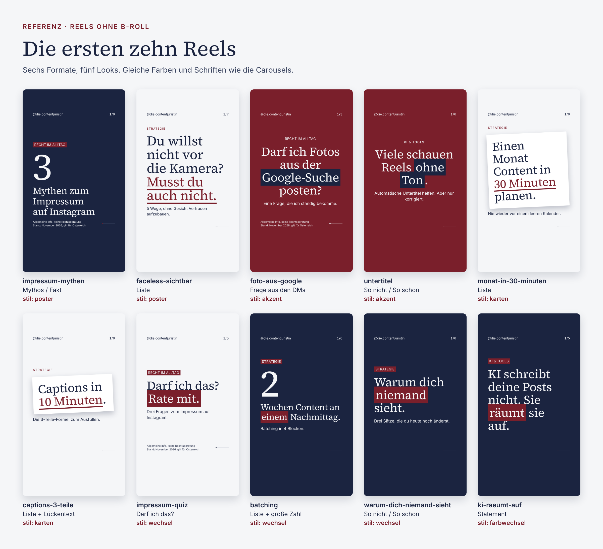

# Referenz: die ersten zehn Reels

Stand: November 2026. Dieser Ordner ist die Vorlage für alle zukünftigen Reels: So sollen sie aussehen, so lang sein und so klingen.

## Inhalt

| Ordner | Was drin ist |
|---|---|
| `videos/` | Die fertigen Reels als MP4 (1080 × 1920, ohne Musik) |
| `titelbilder/` | Das Titelbild zu jedem Reel (PNG) |
| `inhalte/` | Die Textdateien, aus denen die Reels entstanden sind. Zum Abschauen und Kopieren |
| `uebersicht.png` | Alle Titelbilder auf einen Blick |

## Die Reels

| Reel | Säule | Format | Look (`stil`) | Länge |
|---|---|---|---|---|
| impressum-mythen | Recht im Alltag | `mythos-fakt` | `poster` | 22 s |
| faceless-sichtbar | Strategie | `liste` | `poster` | 21 s |
| foto-aus-google | Recht im Alltag | `dm-frage` | `akzent` | 18 s |
| untertitel | KI & Tools | `vergleich` | `akzent` | 20 s |
| monat-in-30-minuten | Strategie | `liste` | `karten` | 19 s |
| captions-3-teile | Strategie | `liste` mit `beispiel` und Lücken | `karten` | 21 s |
| impressum-quiz | Recht im Alltag | `darf-ich` | `wechsel` | 19 s |
| batching | Strategie | `liste` mit `zahl` | `wechsel` | 18 s |
| warum-dich-niemand-sieht | Strategie | `vergleich` | `wechsel` | 24 s |
| ki-raeumt-auf | KI & Tools | `statement` | `farbwechsel` | 13 s |

## Was diese Reels ausmacht

- **Nur die Markenfarben:** Papier, Navy, Dunkelrot. Kein helles Rot, keine weiteren Farben.
- **Tempo:** 13 bis 24 Sekunden, pro Folie nur ein Gedanke.
- **Bewegung:** Wörter kommen nacheinander, Schlüsselwörter werden angestrichen, Folien wechseln wie beim Swipen.
- **Abwechslung:** Nebeneinander im Profil nie zweimal derselbe Look.
- **Recht im Alltag:** immer mit „Allgemeine Info, keine Rechtsberatung“ und Stand.

## Ein neues Reel nach diesem Vorbild

1. Such dir hier das Reel aus, das dem neuen Thema am nächsten kommt.
2. Kopier seine Datei aus `inhalte/` nach `reels/inhalte/` (oder nimm eine Leer-Vorlage aus `reels/vorlagen/`).
3. Texte ersetzen, eventuell einen anderen `stil` wählen, speichern. Den Rest erklärt `reels/ANLEITUNG.md`.

Dieser Ordner wird nicht automatisch aktualisiert. Er bleibt so, wie die Reels im November 2026 freigegeben wurden.
